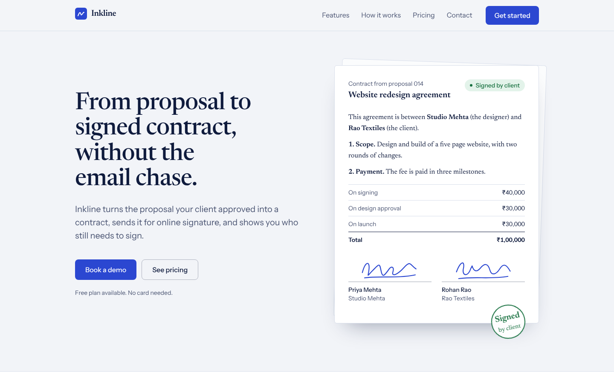
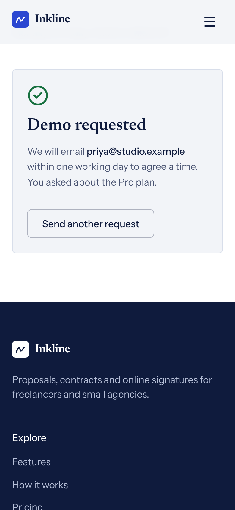

# Inkline

A responsive landing page for **Inkline**, a fictional tool that turns a client-approved proposal into a contract and collects the online signature. Made for the Sankar Group front-end internship assignment. Inkline is not a real product, and every name, price and contact detail on the page is invented.

**Live site:** _add the Vercel link here after deploying_



| Phone (390 px wide)                              | Form success message                                                    |
| ------------------------------------------------ | ----------------------------------------------------------------------- |
|  |  |

## What is on the page

| Section            | What it does                                                                                                                                                                     |
| ------------------ | -------------------------------------------------------------------------------------------------------------------------------------------------------------------------------- |
| Navbar             | Sticky. Logo, four links, and a Get started button that scrolls to pricing. The link for the section in view is highlighted. On phones it becomes a menu button (Esc closes it). |
| Hero               | Headline, short description, two buttons, and a sample contract that signs itself once on load.                                                                                  |
| Features           | Six features in one ruled grid, not six identical cards.                                                                                                                         |
| How it works       | Three numbered steps. This is the only place with numbers because it is a real sequence.                                                                                         |
| Pricing            | Free, Pro and Agency, with a Monthly / Yearly (20% off) switch. Each plan button scrolls to the form with that plan already chosen.                                              |
| Contact and footer | Demo request form with validation and a success message, then the footer.                                                                                                        |

Behaviour that works without any backend:

- Nav links and buttons scroll smoothly to their section and stop below the sticky header.
- The form checks the name, the email format, the team size and a 500 character message limit. Errors appear next to the field, focus moves to the first problem, and errors clear as they are fixed.
- A valid form shows "Sending…" for a moment, then a success message with the email address. "Send another request" opens an empty form.
- Smooth scrolling and the hero animation switch off for people who prefer reduced motion.

## Tech stack

- React 19.3 and Vite 8.3
- Tailwind CSS 4.3 (design tokens live in `src/index.css` under `@theme`)
- lucide-react for icons
- Fonts hosted with the site, no external requests: Newsreader (headings) and Instrument Sans (body)
- ESLint and Prettier
- Playwright for the browser checks in `tests/`

All dependency versions are pinned in `package.json`. Node 20.19 or newer is needed.

## Run it locally

```bash
git clone <your-repo-url>
cd inkline-landing
npm install
npm run dev        # http://localhost:5173
```

Other commands:

```bash
npm run build      # production build in dist/
npm run preview    # serve the build at http://localhost:4173
npm run lint
npm run format
```

No environment variables, API keys or secrets are used.

## Browser checks

`tests/landing_check.cjs` drives the real page with Playwright and runs 26 checks: nav scrolling, the active link, every button, form validation and success, the mobile menu, no sideways scrolling at six widths from 320 px to 1440 px, reduced motion, and no console errors. It also saves the screenshots in `screenshots/`.

```bash
npm install --no-save playwright   # once
npx playwright install chromium    # once
npm run build && npm run preview   # in one terminal
TARGET_URL=http://localhost:4173 node tests/landing_check.cjs   # in another
```

On Windows PowerShell, set the address first: `$env:TARGET_URL="http://localhost:4173"; node tests/landing_check.cjs`.

Last run: 26 of 26 checks passed.

Lighthouse on the production build (run from a cloud container, so treat the numbers as a guide):

|                            | Performance | Accessibility | Best practices | SEO |
| -------------------------- | ----------- | ------------- | -------------- | --- |
| Desktop                    | 100         | 100           | 100            | 100 |
| Mobile (simulated slow 4G) | 90          | 100           | 100            | 100 |

On mobile the score is held back by the web font download under the slow-4G simulation. The first paint in a normal browser was about 0.2 s.

## Project structure

```
src/
  main.jsx                 entry, fonts, styles
  App.jsx                  page layout; holds the selected plan shared by Pricing and Contact
  index.css                design tokens, smooth scroll, hero animation
  data/content.js          all page copy, features, steps and plans in one place
  components/
    layout/                Navbar, Footer
    sections/              Hero, ContractCard, Features, HowItWorks, Pricing, Contact
    ui/                    Button, Section, Logo, StatusChip, FormField
  hooks/useActiveSection.js  highlights the nav link for the section in view
  utils/                   validate.js, format.js, focus.js
tests/landing_check.cjs    Playwright checks
public/                    favicon, robots.txt
```

## Design choices and challenges

1. **The product comes first.** The hero shows the thing Inkline makes, a contract that gets signed, instead of a stock illustration. The signature draws once and the status flips from "Awaiting client" to "Signed by client".
2. **A paper and ink palette.** A cool paper background, deep navy ink and one pen-blue accent. Green is used only for "signed" and red only for errors, so colour always carries meaning.
3. **Two typefaces.** Newsreader for headings gives it the feel of a contract, Instrument Sans keeps the interface text easy to read. Type sizes come from one scale, and text blocks have a maximum width so lines stay comfortable to read.
4. **Not a wall of identical cards.** Features sit in one ruled grid with a larger lead item, and only the "How it works" steps are numbered.
5. **Sticky header challenge.** Headings were hiding under the sticky navbar after a nav click. A `scroll-margin-top` on each section fixes it, and the checks confirm every target lands below the header.
6. **Pricing alignment.** Plan descriptions of different lengths pushed prices out of line, so they now reserve two lines on desktop and the three cards line up.
7. **Small screens.** The rotated sheet behind the contract caused a 1 px sideways scroll at 320 px. It rotates less on phones, and the tests check six widths.
8. **Motion and accessibility.** The one animation respects reduced motion, status text is never half transparent, every field has a label and an error message tied to it, and keyboard focus is always visible.
